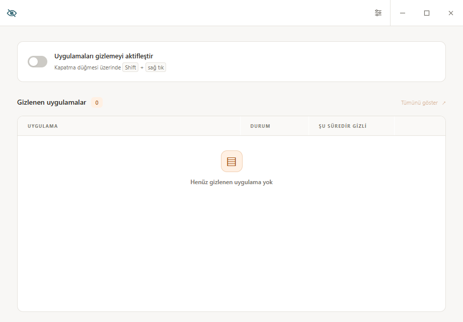

# HideApp

Windows'ta çalışan pencereleri, işlemi sonlandırmadan gizleyen küçük bir masaüstü aracı. Electron arayüzü + önceden derlenmiş C#/.NET yardımcı süreci ile çalışır. Arayüz **Türkçe** ve **English** dillerini destekler.

**Diller / Languages:** [Türkçe](#türkçe) · [English](#english)



---

## Türkçe

### İçindekiler

- [HideApp nedir?](#hideapp-nedir)
- [Kurulum gerektirmeyen portable sürüm](#kurulum-gerektirmeyen-portable-sürüm)
- [Kullanım](#kullanım)
- [Klavye kısayolları](#klavye-kısayolları)
- [Sistem tepsisi](#sistem-tepsisi)
- [Arama](#arama)
- [Görünümü özelleştirme](#görünümü-özelleştirme)
- [Uygulama dili](#uygulama-dili)
- [Veriler nerede saklanır?](#veriler-nerede-saklanır)
- [Kaynak koddan çalıştırma](#kaynak-koddan-çalıştırma)
- [Portable `.exe` derleme](#portable-exe-derleme)
- [Mimari](#mimari)
- [Proje yapısı](#proje-yapısı)
- [Sınırlar](#sınırlar)
- [Sorun giderme](#sorun-giderme)
- [Doğrulama ve testler](#doğrulama-ve-testler)

### HideApp nedir?

HideApp, seçtiğiniz bir pencereyi masaüstünden **ve** görev çubuğundan kaldırır; uygulamanın işlemi arka planda çalışmaya devam eder. Gizlenen pencereler HideApp listesinde tutulur ve tek tek veya toplu olarak geri getirilebilir.

Öne çıkan özellikler:

- **Shift + sağ tık** ile bir pencerenin kapatma düğmesine tıklayarak gizleme; pencere hiçbir zaman kapanmaz, sadece görünmez olur.
- Gizlenen pencerelerin gerçek uygulama ikonları, başlıkları, durumları ve **ne kadardır gizli oldukları** (saniyede bir güncellenen sayaç) ile listelenmesi.
- Adına göre **anlık arama** (Türkçe karakter ve büyük/küçük harf duyarsız), eşleşmeler arasında klavyeyle gezinme ve vurgulama.
- **Sistem tepsisi** desteği: pencereyi kapatmak uygulamayı kapatmaz, tepsiye küçültür; gizleme özelliği çalışmaya devam eder.
- **Tema ve görünüm** seçenekleri: açık/koyu mod, altı renk paleti, yazı tipi, yazı boyutu, arayüz öğesi boyutu ve köşe yuvarlaklığı.
- **Türkçe / English** arayüz; seçim kalıcı olarak saklanır.
- Çıkışta veya beklenmedik kapanmada gizli pencerelerin otomatik geri getirilmesi.

### Kurulum gerektirmeyen portable sürüm

En kolay yol: [Releases](https://github.com/deezwend/hideapp/releases) sayfasından **`HideApp-<sürüm>-portable.exe`** dosyasını indirin.

- **Kurulum gerekmez.** Tek dosyadır; çalıştırdığınızda kendini geçici bir klasöre açar ve uygulamayı başlatır. Program Files'a, kayıt defterine veya başlangıç öğelerine hiçbir şey yazmaz.
- **Taşınabilir.** Dosyayı USB belleğe veya herhangi bir klasöre kopyalayıp çalıştırabilirsiniz.
- **Yönetici hakları gerekmez.** (Yönetici olarak çalışan pencereleri gizlemek isterseniz HideApp'i de yönetici olarak başlatmanız gerekir.)
- **İlk açılış birkaç saniye sürebilir:** portable paket geçici klasöre açılır. C# yardımcısı pakette hazır bulunur; açılışta derleme yapılmaz.

> **Önemli:** Yayınlanan `.exe` dosyaları **kod imzalı değildir**. Windows SmartScreen ilk çalıştırmada "Windows bilgisayarınızı korudu" uyarısını gösterebilir. Devam etmek için **Ek bilgi → Yine de çalıştır** seçeneğini kullanın.

Portable sürüm yalnızca **64 bit Windows 10/11** içindir ve **.NET Framework 4.x** kullanır. Çalışırken PowerShell süreci başlatmaz.

RAM tüketimini azaltmak için tepsiye geçince arayüz süreci kapatılır; pencere gizleme yardımcısı ve tepsi çalışmaya devam eder. Arayüz yeniden açıldığında arama, odak, pencere boyutu ve ayarlar korunur. Varsayılan olarak yazılımsal çizim kullanılır; donanım hızlandırmasını tercih etmek için `HIDEAPP_HARDWARE_ACCELERATION=1` ortam değişkeniyle başlatabilirsiniz. [RAM ölçüm raporu](docs/ram-analysis.md).

### Kullanım

1. HideApp'i açın.
2. **Uygulamaları gizlemeyi aktifleştir** seçeneğini açın.
3. Gizlemek istediğiniz pencerenin sağ üstündeki kapatma düğmesine **Shift + sağ tık** yapın.
4. Pencere masaüstünden ve görev çubuğundan kaldırılır; işlem sonlandırılmaz.
5. Listede **Göster** düğmesiyle pencereyi geri getirin; **Tümünü göster** ile hepsini geri getirin.

Gizlemeyi kapatmak yeni gizlemeleri durdurur; mevcut gizli pencereler listede kalır. HideApp'ten gerçekten çıkıldığında tüm gizli pencereler geri gelir. Electron beklenmedik şekilde kapanırsa yardımcı süreç standart girdi bağlantısının kapanmasını algılayıp pencereleri geri getirir.

### Klavye kısayolları

| Kısayol | İşlev |
| --- | --- |
| `Shift` + sağ tık (pencerenin kapatma düğmesi) | O pencereyi gizle |
| `Ctrl` + `F` | Arama alanını aç ve odakla |
| `Enter` / `Aşağı ok` | Sonraki eşleşen uygulama |
| `Shift` + `Enter` / `Yukarı ok` | Önceki eşleşen uygulama |
| `Escape` | Arama alanını temizle ve kapat; ayarlar açıkken ayarları kapat |
| `Alt` + `F4` veya başlık çubuğundaki `X` | Uygulamayı kapatmak yerine sistem tepsisine küçült |
| Küçültme düğmesi | Normal görev çubuğuna küçültme |

### Sistem tepsisi

Sağ üstteki **X** veya **Alt + F4**, HideApp'i kapatmaz; görev çubuğundan kaldırıp sistem tepsisine gönderir. Gizleme özelliği çalışmayı sürdürür ve gizli pencereler gizli kalır. Tepsi simgesine tıklayarak (veya çift tıklayarak) HideApp'i tekrar açabilirsiniz. Sağ tık menüsünde:

- **HideApp'i göster**
- **Uygulamaları gizlemeyi aktifleştir** (aç/kapa)
- **Tüm gizli pencereleri göster**
- **HideApp'i kapat** (gizli pencereleri geri getirerek gerçek çıkış)

HideApp'i tekrar başlatmak da mevcut pencereyi ön plana getirir (tek örnek kilidi).

### Arama

**Ctrl + F**, başlık çubuğunda pencere kontrollerinin solunda arama alanını açar ve odaklar. Gizlenen pencereler adına göre anında filtrelenir; Türkçe harfler ve büyük/küçük harf farkları desteklenir. Arama sürerken yeni liste güncellemeleri de filtreye uyar. Sayaç eşleşen/toplam sayısını gösterir ve eşleşen metin parçaları seçili renk paletine uygun olarak vurgulanır. Arama alanındaki yukarı/aşağı okları eşleşmeler arasında döngüsel gezinir ve seçili satırı görünür alana kaydırır. **Escape** veya arama alanının kapatma düğmesi aramayı temizleyip tüm listeyi geri getirir. **Tümünü göster**, arama filtresinden bağımsız olarak tüm gizli pencereleri geri getirir.

### Görünümü özelleştirme

Başlık çubuğunda pencere kontrollerinin yanındaki **Görünüm ayarları** düğmesini kullanın.

- Açık / koyu tema; her iki mod da tüm renk paletleriyle çalışır. Varsayılan mod açık temadır.
- Altı renk paleti: **Turuncu** (varsayılan), **Okyanus**, **Turkuaz**, **Orman**, **Kırmızı** ve **Grafit**.
- Yazı tipleri: Segoe UI, Arial, Tahoma, Verdana ve Consolas.
- Yazı boyutu %85–140; arayüz öğelerinin büyüklüğü %85–130. İki ölçek birbirinden bağımsızdır.
- Köşe yuvarlaklığı: 0–20 piksel.
- Seçimler anında uygulanır ve yerel olarak saklanır; uygulama yeniden açıldığında korunur.
- **Varsayılana sıfırla** yalnızca görünümü sıfırlar; gizleme seçeneğini, gizli pencereleri veya dili değiştirmez.
- Ayarlar `Escape` tuşuyla ya da kapatma düğmesiyle kapatılabilir.

### Uygulama dili

Ayarlar panelindeki **Uygulama dili** seçeneğiyle arayüz **Türkçe** veya **English** olarak kullanılabilir ve seçim kalıcı olarak saklanır.

- Tüm görünür metinler çevrilir: düğmeler, sütun başlıkları, boş liste mesajı, arama alanı, ipuçları ve sistem tepsisi menüsü.
- Süre sayaçları da seçilen dile uyar (örn. `1 sa 2 dk 36 sn` / `1 h 2 min 36 s`).
- Değişiklik anında uygulanır; arama, gizlenen pencereler ve tema ayarları etkilenmez.
- Dil, görünümden bağımsız saklanır; **Varsayılana sıfırla** yalnızca görünümü sıfırlar, dili değiştirmez.
- Kullanılamayan bir dil istenirse mevcut dil korunur ve durum alanında uyarı gösterilir.

### Veriler nerede saklanır?

HideApp hiçbir veriyi internete göndermez; ağ bağlantısı kullanmaz.

| Veri | Konum |
| --- | --- |
| Dil seçimi | `%APPDATA%\hideapp\language.json` |
| Görünüm ayarları (tema, palet, yazı tipi, ölçekler) | `%APPDATA%\hideapp` altındaki Chromium profilindeki `localStorage` (`hideapp.appearance.v1` anahtarı) |

Portable sürüm de aynı klasörü kullanır; uygulamayı silmek için `.exe` dosyasını silmeniz yeterlidir, kalan tek şey bu küçük ayar klasörüdür.

### Kaynak koddan çalıştırma

Gereksinimler: **Windows 10/11**, **Node.js 18+** ve **Windows PowerShell 5.1** (.NET Framework ile birlikte gelir).

```sh
npm install
npm start
```

`npm install` Electron'u indirir. `npm start`, testler ve `npm run dist` öncesinde yardımcı C# kodu Windows'un .NET Framework derleyicisiyle derlenir. Dağıtılan portable pakette yardımcı hazırdır.

### Portable `.exe` derleme

```sh
npm install
npm run dist
```

Çıktı: `dist/HideApp-<sürüm>-portable.exe` (tek dosya, kurulum gerektirmez).

Ek komutlar:

| Komut | Açıklama |
| --- | --- |
| `npm run dist` | Windows için portable `.exe` üretir (`electron-builder --win portable`) |
| `npm run icons` | `assets/icon-source.png` kaynağından `assets/icon.png`, `assets/tray-icon.png` ve `assets/icon.ico` dosyalarını yeniden üretir |
| `npm run check` | Kaynak dosyaların sözdizimini denetler |
| `npm test` | Çeviri, süre biçimlendirme, tema ve yerel pencere gizleme testleri |
| `npm run test:electron` | Electron açılışı, IPC, tepsi ve arayüz uçtan uca duman testi |

Derleme notları:

- Paket **asar arşivi kullanmaz** (`"asar": false`). `native/WindowHost.exe` gerçek bir dosya olarak paketlenir ve doğrudan çalıştırılır.
- Paketlenen dosyalar: `src/**`, `native/**`, `assets/icon.png`, `assets/tray-icon.png` ve `package.json`.
- İlk derlemede `electron-builder` Electron dağıtımını indirir (önbelleğe alınır).
- Kod imzalama sertifikası tanımlı değildir; üretilen `.exe` imzasızdır.
- `dist/` klasörü sürüm kontrolüne dâhil edilmez (`.gitignore`).

### Mimari

```
┌──────────────────────────────┐        ┌────────────────────────────────────┐
│  Electron ana süreç          │  IPC   │  Electron arayüzü (renderer)       │
│  src/main.js                 │◄──────►│  src/index.html + renderer.js      │
│  pencere, tepsi, dil, IPC    │        │  liste, arama, tema, ayarlar       │
└──────────────┬───────────────┘        └────────────────────────────────────┘
               │  satır tabanlı JSON protokolü (stdin/stdout)
               ▼
┌──────────────────────────────────────────────────────────────────────────────┐
│  Derlenmiş C# yardımcı süreç: native/WindowHost.exe                          │
│  Win32 API: pencere numaralandırma, ShowWindow ile gizleme/geri getirme,     │
│  kapatma düğmesi izleme, pencere ikonu çıkarma                              │
└──────────────────────────────────────────────────────────────────────────────┘
```

- **Renderer** hiçbir sistem çağrısı yapmaz; yalnızca `preload.js` üzerinden sınırlı bir IPC API'si (`window.hideApp`) kullanır (`contextIsolation: true`, `sandbox: true`, `nodeIntegration: false`).
- **Ana süreç**, yardımcı süreçle satır tabanlı JSON mesajları alışverişi yapar (`enable 1`, `restore-all`, `restore <id>`, `quit` gibi komutlar; `ready`, `state`, `error` olayları).
- **Yardımcı süreç** Win32 API'siyle çalışır: pencereleri numaralandırır, kapatma düğmesine `Shift + sağ tık` yapıldığını algılar, pencereyi `ShowWindow(SW_HIDE)` ile gizler ve istendiğinde `SW_RESTORE` + `SetForegroundWindow` ile geri getirir. Electron kapanırsa standart girdi kapanır, yardımcı süreç tüm pencereleri geri getirip çıkar.
- **Güvenlik**: `contextIsolation`, `sandbox`, katı CSP (`default-src 'self'`), `will-navigate` ve `setWindowOpenHandler` engelleri; uzak içerik yüklenmez.

### Proje yapısı

```
assets/     ikon kaynağı ve türetilmiş ikonlar (icon-source.png, icon.png, tray-icon.png, icon.ico)
docs/       README ekran görüntüsü
native/     C# pencere yardımcısı (WindowHost.cs, Entry.cs → WindowHost.exe)
scripts/    electron çalıştırıcısı ve ikon üreticisi
src/        Electron ana süreç, preload, arayüz, stil, tema/dil/süre modülleri
test/       Node testleri, Electron duman testi, PowerShell fixture'ları
```

### Sınırlar

- Standart Windows kapatma düğmeleri doğrudan algılanır. Discord ve benzeri Chromium/Electron pencerelerinde, standart hit-test yoksa sağ üstteki 28 × 32 mantıksal piksellik bölge ek olarak kullanılır; ekran ölçeklendirmesi hesaba katılır. Bu bir konum tahminidir: farklı yerleşimli kapatma düğmeleri ve Chromium dışındaki özel başlık çubukları garanti edilmez. Tam ekran Chromium pencerelerinde bu tahmin uygulanmaz.
- Yönetici yetkisiyle çalışan hedeflere erişmek için HideApp'in de aynı yetki düzeyinde çalışması gerekebilir.
- Gizlenen bir **pencere**dir, tüm uygulama işlemi değil. Aynı uygulamanın başka pencereleri ve sistem tepsisi ikonları görünür kalabilir.
- Gizleme bir güvenlik veya gizlilik sınırı değildir. İşlemler Görev Yöneticisi'nde görünür ve uygulama bildirim gönderebilir veya kendini tekrar gösterebilir.
- Yardımcı süreci zorla sonlandırmak otomatik geri getirmeyi engelleyebilir. Normal çıkış için sistem tepsisi menüsündeki **HideApp'i kapat** seçeneğini kullanın.
- .NET Framework yalnızca Windows API yardımcı sürecini çalıştırır; arayüz Electron'dur. Yardımcı paketleme sırasında derlenir.
- Uygulama yalnızca Windows içindir; diğer platformlarda arayüz açılır ama gizleme çalışmaz ve durum alanında "yalnızca Windows" uyarısı görünür.

### Sorun giderme

| Belirti | Çözüm |
| --- | --- |
| SmartScreen "Windows bilgisayarınızı korudu" uyarısı | Beklenen durumdur (imzasız `.exe`). **Ek bilgi → Yine de çalıştır** |
| Liste boş ve durum alanında `helperStopped` benzeri bir hata | Yardımcı süreç kapanmış. HideApp'i kapatıp yeniden açın |
| Hiçbir pencere gizlenmiyor | **Uygulamaları gizlemeyi aktifleştir** açık mı? Gizleme için kapatma düğmesine **Shift + sağ tık** gerekir (normal tıklama değil) |
| Yönetici pencereleri gizlenmiyor | HideApp'i yönetici olarak çalıştırın |
| İlk açılış birkaç saniye sürüyor | Portable paket geçici klasöre açılıyor; yardımcı süreç zaten derlenmiştir |
| Antivirüs uyarısı | İmzasız paket yanlış pozitif uyarı alabilir; dosyanın kaynağını ve release SHA-256 değerini doğrulayın veya kaynak koddan derleyin |
| Portable `.exe` her açılışta yavaş | Portable paket kendini `%TEMP%` klasörüne açar; bu normaldir. Hızlı açılış isterseniz `dist/win-unpacked/HideApp.exe` gibi açılmış sürümü kullanın |

### Doğrulama ve testler

```sh
npm run check
npm test
npm run test:electron
```

- `npm run check`: tüm kaynak dosyaların sözdizimini denetler.
- `npm test` (`node --test`): çeviri kataloglarını, süre biçimlendirmesini, tema normalizasyonunu, yerel gizleme/geri getirme davranışını ve Chromium kapatma bölgesi hesabını doğrular. İzole bir Windows test penceresinde gerçek gizleme, işlem sürekliliği, tekli/toplu geri getirme ve bağlantı kapanınca geri getirme sınanır. Fare hareket ettirilmez; test modunda yalnızca fixture penceresine erişilir. Gerçek `Shift + sağ tık` hareketi otomatik testin kapsamı dışındadır.
- `npm run test:electron`: Electron açılışını, preload/IPC iletişimini, tepsi menüsünü, dil değişimini, arama ve klavye gezinmesini, tema/ölçek kalıcılığını ve küçük pencere yerleşimini uçtan uca sınar.

---

## English

### Table of contents

- [What is HideApp?](#what-is-hideapp)
- [Portable build (no installation)](#portable-build-no-installation)
- [Usage](#usage)
- [Keyboard shortcuts](#keyboard-shortcuts)
- [System tray](#system-tray)
- [Search](#search)
- [Customizing the appearance](#customizing-the-appearance)
- [Application language](#application-language)
- [Where data is stored](#where-data-is-stored)
- [Running from source](#running-from-source)
- [Building the portable `.exe`](#building-the-portable-exe)
- [Architecture](#architecture)
- [Project layout](#project-layout)
- [Limitations](#limitations)
- [Troubleshooting](#troubleshooting)
- [Verification and tests](#verification-and-tests)

### What is HideApp?

HideApp removes a window you choose from the desktop **and** the taskbar while the application process keeps running in the background. Hidden windows are listed in HideApp and can be restored individually or all at once.

Highlights:

- Hide a window by **Shift + right-clicking** its close button; the window never closes, it just becomes invisible.
- The list shows each hidden window's real application icon, title, status and **how long it has been hidden** (counter refreshed every second).
- **Live search** by name (Turkish characters and case differences supported), keyboard navigation across matches and match highlighting.
- **System tray** support: closing the window minimizes it to the tray instead of quitting; hiding keeps working and hidden windows stay hidden.
- **Theme and appearance** options: light/dark mode, six color palettes, font family, text size, interface element size and corner radius.
- **Turkish / English** interface with a persisted choice.
- Hidden windows are restored automatically on exit or on an unexpected crash.

### Portable build (no installation)

The easiest path: download **`HideApp-<version>-portable.exe`** from the [Releases](https://github.com/deezwend/hideapp/releases) page.

- **No installation.** It is a single file that unpacks itself into a temporary folder and starts the app. Nothing is written to Program Files, the registry or startup entries.
- **Truly portable.** Copy the file to a USB stick or any folder and run it.
- **No administrator rights required.** (To hide windows that run elevated, start HideApp elevated as well.)
- **The first launch can take a few seconds:** the portable package unpacks to a temporary folder. The C# helper is already compiled; no startup compilation occurs.

> **Important:** the published `.exe` files are **not code signed**. Windows SmartScreen may show "Windows protected your PC" on first launch. Choose **More info → Run anyway** to continue.

The portable build targets **64-bit Windows 10/11** and uses **.NET Framework 4.x**. It does not launch PowerShell at runtime.

To reduce RAM usage, moving to the tray releases the UI process while the helper and tray remain active. Search, focus, window size and settings survive reopening. Software drawing is the default; launch with the `HIDEAPP_HARDWARE_ACCELERATION=1` environment variable to opt into hardware acceleration. [RAM measurement report](docs/ram-analysis.md).

### Usage

1. Open HideApp.
2. Turn on **Enable application hiding**.
3. **Shift + right-click** the close button at the top right of the window you want to hide.
4. The window is removed from the desktop and the taskbar; the process is not terminated.
5. Use **Show** in the list to bring a window back, or **Show all** to restore every hidden window.

Turning hiding off only stops new hides; already hidden windows stay in the list. When you actually quit HideApp, all hidden windows are restored. If Electron exits unexpectedly, the helper process notices that standard input has closed and restores the windows.

### Keyboard shortcuts

| Shortcut | Action |
| --- | --- |
| `Shift` + right-click (on a window's close button) | Hide that window |
| `Ctrl` + `F` | Open and focus the search field |
| `Enter` / `Down arrow` | Next matching application |
| `Shift` + `Enter` / `Up arrow` | Previous matching application |
| `Escape` | Clear and close the search field; close the settings dialog when it is open |
| `Alt` + `F4` or the title bar `X` | Minimize to the system tray instead of quitting |
| Minimize button | Normal minimize to the taskbar |

### System tray

The **X** in the top right or **Alt + F4** does not quit HideApp; it removes it from the taskbar and moves it to the system tray. Hiding keeps working and hidden windows stay hidden. Click (or double-click) the tray icon to bring HideApp back. The right-click menu contains:

- **Show HideApp**
- **Enable application hiding** (toggle)
- **Show all hidden windows**
- **Quit HideApp** (real exit that restores hidden windows)

Launching HideApp again also brings the existing window to the foreground (single-instance lock).

### Search

**Ctrl + F** opens and focuses the search field to the left of the window controls in the title bar. Hidden windows are filtered by name instantly, with support for Turkish characters and case differences. While a search is active, new list updates are filtered too. The counter shows matched/total, and matching text fragments are highlighted using the selected palette. The up/down arrows inside the search field cycle through matches and scroll the selected row into view. **Escape** or the search field's close button clears the search and brings the full list back. **Show all** restores every hidden window regardless of the search filter.

### Customizing the appearance

Use the **Appearance settings** button next to the window controls in the title bar.

- Light / dark mode; both work with every palette. The default mode is light.
- Six palettes: **Orange** (default), **Ocean**, **Teal**, **Forest**, **Crimson** and **Slate**.
- Fonts: Segoe UI, Arial, Tahoma, Verdana and Consolas.
- Text size 85–140%; interface element size 85–130%. The two scales are independent.
- Corner radius: 0–20 pixels.
- Changes apply instantly and are stored locally; they survive a restart.
- **Reset to defaults** only resets the appearance; it does not change the hiding toggle, hidden windows or the language.
- The dialog closes with `Escape` or its close button.

### Application language

The **Application language** option in the settings panel switches the interface between **Turkish** and **English**, and the choice is persisted.

- Every visible string is translated: buttons, column headers, the empty-list message, the search field, tooltips and the tray menu.
- Duration counters follow the selected language too (e.g. `1 sa 2 dk 36 sn` / `1 h 2 min 36 s`).
- The change applies instantly; search, hidden windows and theme settings are unaffected.
- The language is stored independently of the appearance; **Reset to defaults** only resets the appearance.
- If an unavailable language is requested, the current language is kept and a warning is shown in the status area.

### Where data is stored

HideApp never sends any data anywhere and does not use the network.

| Data | Location |
| --- | --- |
| Language choice | `%APPDATA%\hideapp\language.json` |
| Appearance settings (mode, palette, font, scales) | `localStorage` inside the Chromium profile under `%APPDATA%\hideapp` (key `hideapp.appearance.v1`) |

The portable build uses the same folder, so removing the app means deleting the `.exe`; only this small settings folder remains.

### Running from source

Requirements: **Windows 10/11**, **Node.js 18+** and **Windows PowerShell 5.1** (ships with the .NET Framework).

```sh
npm install
npm start
```

`npm install` downloads Electron. `npm start`, tests and `npm run dist` compile the helper using the Windows .NET Framework compiler. The distributed portable package includes the compiled helper.

### Building the portable `.exe`

```sh
npm install
npm run dist
```

Output: `dist/HideApp-<version>-portable.exe` (a single file, no installation required).

Additional commands:

| Command | Description |
| --- | --- |
| `npm run dist` | Builds the Windows portable `.exe` (`electron-builder --win portable`) |
| `npm run icons` | Regenerates `assets/icon.png`, `assets/tray-icon.png` and `assets/icon.ico` from `assets/icon-source.png` |
| `npm run check` | Syntax-checks the source files |
| `npm test` | Translation, duration formatting, theme and native hide/restore tests |
| `npm run test:electron` | End-to-end smoke test of Electron startup, IPC, tray and UI |

Build notes:

- The package **does not use an asar archive** (`"asar": false`). `native/WindowHost.exe` is packaged as a real file and launched directly.
- Packaged files: `src/**`, `native/**`, `assets/icon.png`, `assets/tray-icon.png` and `package.json`.
- The first build downloads the Electron distribution with `electron-builder` (cached afterwards).
- No code signing certificate is configured, so the produced `.exe` is unsigned.
- The `dist/` folder is not tracked by version control (`.gitignore`).

### Architecture

```
┌──────────────────────────────┐        ┌────────────────────────────────────┐
│  Electron main process       │  IPC   │  Electron UI (renderer)            │
│  src/main.js                 │◄──────►│  src/index.html + renderer.js      │
│  window, tray, language, IPC │        │  list, search, theme, settings     │
└──────────────┬───────────────┘        └────────────────────────────────────┘
               │  line-based JSON protocol (stdin/stdout)
               ▼
┌──────────────────────────────────────────────────────────────────────────────┐
│  Compiled C# helper: native/WindowHost.exe                                  │
│  Win32 API: window enumeration, hide/restore via ShowWindow,                │
│  close-button watching, window icon extraction                              │
└──────────────────────────────────────────────────────────────────────────────┘
```

- The **renderer** never makes system calls; it only uses a narrow IPC API (`window.hideApp`) exposed through `preload.js` (`contextIsolation: true`, `sandbox: true`, `nodeIntegration: false`).
- The **main process** exchanges line-based JSON messages with the helper (`enable 1`, `restore-all`, `restore <id>`, `quit` commands; `ready`, `state`, `error` events).
- The **helper** drives the Win32 API: it enumerates windows, detects a `Shift + right click` on a close button, hides the window with `ShowWindow(SW_HIDE)` and restores it with `SW_RESTORE` + `SetForegroundWindow` on request. If Electron exits, standard input closes and the helper restores every window before exiting.
- **Security**: `contextIsolation`, `sandbox`, a strict CSP (`default-src 'self'`) and `will-navigate` / `setWindowOpenHandler` blocks; no remote content is loaded.

### Project layout

```
assets/     icon source and derived icons (icon-source.png, icon.png, tray-icon.png, icon.ico)
docs/       README screenshot
native/     C# window helper (WindowHost.cs, Entry.cs → WindowHost.exe)
scripts/    Electron launcher and icon generator
src/        Electron main process, preload, UI, styles, theme/language/duration modules
test/       Node tests, Electron smoke test, PowerShell fixtures
```

### Limitations

- Standard Windows close buttons are detected directly. For Discord-like Chromium/Electron windows without a standard hit test, a 28 × 32 logical pixel region at the top right is used as a fallback, taking display scaling into account. This is a positional estimate: differently placed close buttons and custom title bars outside Chromium are not guaranteed. The estimate is not applied to full-screen Chromium windows.
- Reaching elevated targets may require running HideApp at the same privilege level.
- A **window** is hidden, not the whole application process. Other windows of the same application and its tray icons may stay visible.
- Hiding is not a security or privacy boundary. Processes remain visible in Task Manager and an application can still post notifications or show itself again.
- Force-killing the helper process can prevent automatic restore. Use **Quit HideApp** from the tray menu for a clean exit.
- .NET Framework runs the Windows API helper; the UI is Electron. The helper is compiled when building the package.
- The app is Windows-only; on other platforms the UI opens but hiding does nothing and a "Windows only" warning appears in the status area.

### Troubleshooting

| Symptom | Fix |
| --- | --- |
| SmartScreen "Windows protected your PC" | Expected for an unsigned `.exe`. Choose **More info → Run anyway** |
| Empty list with a `helperStopped`-like error in the status area | The helper process exited. Close HideApp and start it again |
| Nothing gets hidden | Is **Enable application hiding** on? Hiding needs a **Shift + right click** on the close button (a normal click does not work) |
| Elevated windows are not hidden | Run HideApp as administrator |
| The first launch takes a few seconds | The portable package is unpacking into a temporary folder; the helper is already compiled |
| Antivirus warning | An unsigned package may trigger a false positive; verify its origin and release SHA-256 or build from source |
| The portable `.exe` is slow on every launch | The portable package unpacks itself into `%TEMP%`; this is normal. For fast startup use an unpacked build such as `dist/win-unpacked/HideApp.exe` |

### Verification and tests

```sh
npm run check
npm test
npm run test:electron
```

- `npm run check`: syntax-checks every source file.
- `npm test` (`node --test`): validates the translation catalogs, duration formatting, theme normalization, the native hide/restore behavior and the Chromium close-button region math. It exercises real hiding, process continuity, single and bulk restore, and restore-on-connection-close against an isolated Windows test window. It does not move the mouse and only touches the fixture window in test mode. A real `Shift + right click` gesture is outside the scope of the automated test.
- `npm run test:electron`: end-to-end checks of Electron startup, preload/IPC, the tray menu, language switching, search and keyboard navigation, theme/scale persistence and the minimum-window layout.
